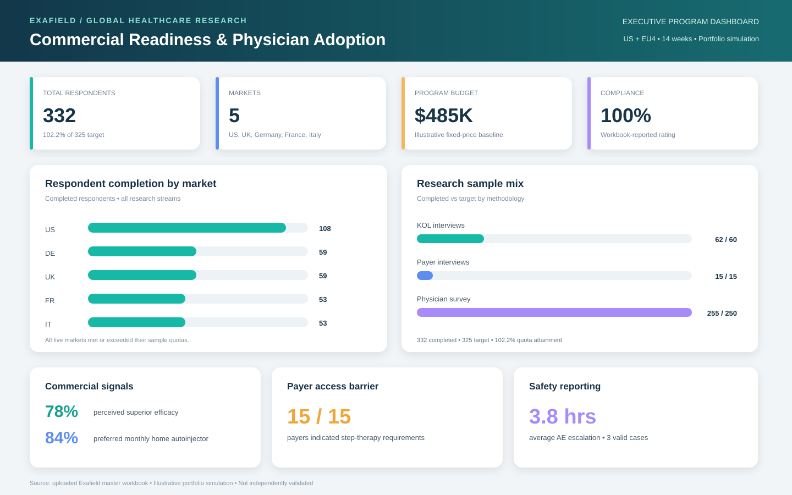

# Exafield Executive Dashboard

A visual executive dashboard for the fictionalized Global Biologic Commercial Readiness & Physician Adoption Study.

## Dashboard preview

The dashboard is the visual below. If it does not render in your GitHub view, [open the SVG dashboard directly](Executive-Dashboard.svg).

## Power BI Desktop assets

This folder also contains the source data, theme and DAX measures needed to build an editable Power BI report:

- `Market_Recruitment.csv`
- `Research_Stream_Summary.csv`
- `Strategic_Findings.csv`
- `Adverse_Events.csv`
- `Program_KPIs.csv`
- `Exafield-PowerBI-Theme.json`
- `Measures.dax`

Import the CSV files into Power BI Desktop, apply the theme using **View → Themes → Browse for themes**, and create the measures from `Measures.dax`.

## Suggested report pages

1. **Executive Overview:** respondents, quota attainment, budget, duration, compliance, market completion and research-stream target vs actual.
2. **Recruitment & Fieldwork:** target vs completed by research stream and country.
3. **Commercial Insights:** efficacy perception, autoinjector preference, payer step-therapy, co-pay sensitivity and recommendations.
4. **Safety & Compliance:** AE count, average escalation turnaround, 24-hour operating-threshold compliance and incident table.

## Data notes

- Target: 325 respondents; completed: 332 (approximately 102.2% attainment).
- Market completions: US 108, Germany 59, UK 59, France 53 and Italy 53.
- Three valid AE mentions; workbook-reported average escalation turnaround: 3.8 hours.
- Commercial findings are study-reported findings, not independently validated market facts.
- This is a fictionalized portfolio simulation. Do not represent the illustrative budget, client context, respondent counts or findings as verified client-confidential project results.

## Important: native Power BI file

The SVG above is a **static dashboard preview**, not an interactive Power BI report. This repository currently does **not** contain a native `.pbix` file. The included data, theme and DAX are the build assets for creating the editable report in Power BI Desktop.
