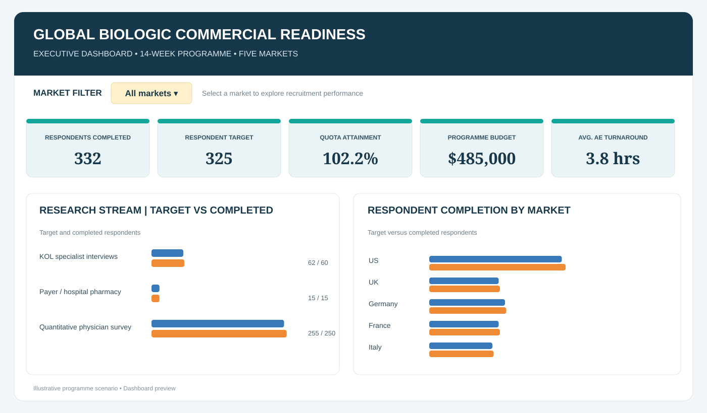

# Global Pharmaceutical Commercial Readiness & Physician Adoption Study

## Project overview

A 14-week, five-market commercial-readiness and physician-adoption research program for a newly approved biologic therapy. The study combines qualitative specialist and payer interviews with a quantitative physician survey to assess prescribing intent, access barriers and patient-administration considerations ahead of commercial launch.

## Programme snapshot

| Measure | Scenario result |
|---|---:|
| Duration | 14 weeks |
| Markets | United States, United Kingdom, Germany, France and Italy |
| Illustrative programme budget | USD 485,000 |
| Respondent target | 325 |
| Respondents completed | 332 |
| Quota attainment | 102.1% (source workbook) |
| Valid adverse-event mentions | 3 |
| Average AE escalation turnaround | 3.8 hours |

## Research design

- 60 target KOL specialist interviews (62 completed).
- 15 target payer / hospital-pharmacy interviews (15 completed).
- 250 target quantitative physician surveys (255 completed).

## Dashboard preview

## Workbook deliverables

Two Excel workbooks are included in this project folder:

| Workbook | Purpose |
|---|---|
| [Original master workbook](Exafield_Global_Biologic_Market_Research_Master_Artifact.xlsx) | Original source workbook, retained unchanged. Contains the five source worksheets: Executive Dashboard, 14-Week Fieldwork Schedule, Sample & Recruitment Tracker, Adverse Event Log, and Key Findings & Insights. |
| [Interactive Excel dashboard](Exafield_Interactive_Dashboard_VERIFIED.xlsx) | Enhanced workbook with the five source worksheets retained and an additional Interactive_Dashboard worksheet. Includes a market selector, KPI cards, a selected-market target-versus-completed chart and a country comparison chart. |

For the interactive workbook, open it in Microsoft Excel desktop and allow workbook calculations to update. Use the market selector on the Interactive_Dashboard worksheet to view market-level recruitment metrics.

## Supporting project artifacts

| Artifact | Description |
|---|---|
| [Project Charter](01-Project-Charter.md) | Purpose, objectives, scope, deliverables and success measures |
| [14-Week Fieldwork Schedule](02-14-Week-Fieldwork-Schedule.csv) | Work breakdown, owners, milestones and status |
| [Sample & Recruitment Tracker](03-Sample-and-Recruitment-Tracker.csv) | Country quotas and completed respondent counts |
| [Adverse Event Log](04-Adverse-Event-Log.csv) | Incident-level safety escalation log |
| [Key Findings & Insights](05-Key-Findings-and-Insights.csv) | Commercial findings, risks and recommendations |
| [RACI & Governance](06-RACI-and-Governance.md) | Workstream accountability and stakeholder roles |
| [RAID Register](07-RAID-Register.md) | Key risks, assumptions, issues and dependencies |
| [Protocol & Compliance Overview](08-Protocol-and-Compliance-Overview.md) | Research design, screening and safety controls |
| [Week 7 Recruitment Recovery Plan](09-Week-7-Recruitment-Recovery-Plan.md) | Root cause, corrective actions and recovery outcome |
| [Quality & Data Validation Plan](10-Quality-and-Data-Validation-Plan.md) | Qualitative, quantitative and safety quality controls |
| [Executive Recommendations](11-Executive-Recommendations.md) | Findings translated into commercial actions |
| [Data Dictionary](12-Data-Dictionary.md) | Workbook structure and KPI definitions |

## Delivery approach

The program was managed through five lifecycle phases: study scoping and protocol development; compliance, ethical approvals and translation; recruitment and fieldwork; data validation and quality control; and synthesis with executive delivery.

At the Week 7 checkpoint, hospital specialist recruitment in Germany and the UK was approximately 40% of the time-phased target. Evening and weekend interview slots, bilingual senior moderators and pre-screened regional medical panels were introduced. Recruitment recovered within 10 days and fieldwork remained on schedule.

## Executive findings

The scenario reports that 78% of specialists rated efficacy superior to current standard of care, 84% preferred a monthly home autoinjector over IV infusion, and all 15 interviewed payers anticipated step-therapy requirements. Recommendations included prior-authorization support for prescribing clinics and an ergonomic trainer pen in patient starter packs.

## Portfolio context

This is a portfolio case study based on a constructed project scenario. Budget, respondent counts, client context, findings and outcomes are illustrative scenario figures and are not independently verified claims about a real client engagement. No patient-identifiable information is included.
