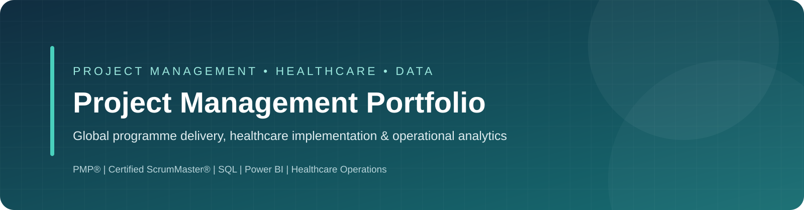

  

**PMP® | Certified ScrumMaster® | Healthcare Project & Programme Delivery | PMO | Data Analytics**

---

## Professional focus

This portfolio presents practical case studies and delivery artefacts across healthcare operations, technology implementation, market research, PMO governance and data analytics.

The work demonstrates how complex initiatives are structured, governed, monitored and translated into measurable operational or commercial outcomes. Each case study is supported by relevant project documentation, working files, analytical outputs or implementation artefacts.

## Featured case studies

### 01 — Global Pharmaceutical Commercial Readiness & Physician Adoption

A 14-week, five-market research programme assessing physician adoption, payer access requirements and patient-administration considerations for a newly approved biologic therapy.

**Programme management focus:** research design, international fieldwork, recruitment recovery, governance, quality assurance, pharmacovigilance controls and executive recommendations.

**Deliverables:** project charter, fieldwork schedule, recruitment tracker, adverse-event log, RACI, RAID register, quality plan, executive recommendations, source workbook and interactive Excel dashboard.

[Explore the pharmaceutical commercial-readiness case study →](11-Global-Pharmaceutical-Commercial-Readiness-Study/)

### 02 — Salesforce CRM Implementation

A structured implementation case study focused on CRM delivery, stakeholder coordination, process alignment, integration dependencies, testing, change management and operational reporting.

[Explore Salesforce CRM case study →](03-Salesforce-CRM/)

### 03 — Electronic Prior Authorization (ePA)

A healthcare technology implementation case study covering workflow integration, clinical and operational stakeholders, implementation planning, testing, training, go-live readiness and hypercare.

[Explore ePA implementation case study →](10-Electronic-Prior-Authorization/)

### 04 — Hospital Clinical Platform Implementation

An implementation case study focused on hospital technology deployment, clinical workflow alignment, stakeholder readiness, training and go-live governance.

[Explore hospital platform implementation →](09-Hospital-Clinical-Platform-Implementation/)

## Portfolio library

| Area | Focus |
|---|---|
| Healthcare market research | Research programme delivery, physician insights and commercial readiness |
| Healthcare operations | Process improvement, operational controls and performance reporting |
| Technology implementation | Salesforce CRM, ePA and hospital clinical platforms |
| PMO & project governance | Charters, schedules, RAID, RACI, status reporting and delivery controls |
| Data analytics | SQL, Power BI, data modelling, dashboards and KPI reporting |
| Project management resources | Reusable templates, planning tools and delivery documentation |
| Python projects | Foundational programming exercises and applied learning |

## Core capabilities

- **Programme and project delivery:** scope, work breakdown structures, schedules, milestones, dependencies, budgets, RAID management and governance.
- **Stakeholder and vendor coordination:** cross-functional alignment, escalation management, communication planning and executive reporting.
- **Healthcare operations and implementation:** clinical workflow coordination, process improvement, change management, training and go-live readiness.
- **Research operations:** qualitative and quantitative study coordination, recruitment tracking, data quality and compliance-oriented workflows.
- **Data and reporting:** SQL, Power BI, DAX, Excel, KPI design and data modelling.

## Certifications

- Project Management Professional (PMP®)
- Certified ScrumMaster (CSM®)

## Tools and technologies

**Project delivery:** Microsoft Project, Jira, project plans, RACI, RAID and governance artefacts  
**Data and reporting:** SQL, Power BI, DAX, Excel, PostgreSQL, MySQL  
**Platforms and workflow:** Salesforce CRM, GitHub  
**Programming:** Python (currently developing practical skills)

## How to navigate this portfolio

The numbered folders contain case studies, supporting documentation, datasets, dashboards and project artefacts. Open an individual folder to review its project overview and associated deliverables.

---

*Structured delivery. Clear governance. Actionable insight.*

> **Portfolio transparency:** Certain case studies use constructed scenarios and illustrative project data to demonstrate programme-management methods and artefact development. Scenario-based figures are identified within the relevant project documentation and should not be interpreted as independently verified client results.
